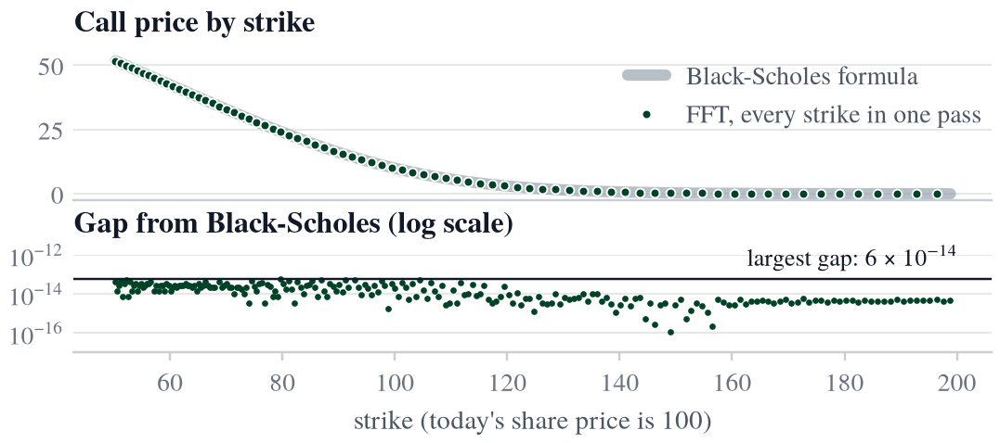

# Pricing Options with the Fourier Transform

Pricing European options with the fast Fourier transform (Carr-Madan), built from first principles in Python and checked against Black-Scholes.



One FFT pass prices 4,096 strikes in about 0.2 ms. At every grid strike from 50 to 200 it is within 6e-14 of the exact Black-Scholes price.

**Read the write-up: [writeup.pdf](writeup.pdf)** (4 pages, plain English, mostly figures).

## How it works

An option's price is the average payoff across every price the share could end at, weighted by how likely each one is. Realistic models rarely give those chances as a formula, but they usually give their fingerprint (the Fourier transform). The method only uses the fingerprint:

1. **Fingerprint:** turn each possible outcome into an arrow and average them. This is the only part that depends on the model.
2. **Damp:** multiply the call price by a power of the strike so that it dies away at both ends and can be transformed.
3. **Wind up:** build the transform of the damped price straight from the fingerprint, without knowing any prices.
4. **Unwind with the FFT:** transform back for every strike at once, then undo the damping.

## Results

Running example: share price 100, one year, 4% interest, 20% volatility, damping 1.5.

| | |
|---|---|
| Largest gap from Black-Scholes, strikes 50 to 200 | 6e-14 |
| One strike at a time (`scipy.integrate.quad`) | about 0.5 ms per strike, about 2 s for all 4,096 |
| All 4,096 strikes in one FFT | about 0.2 ms |
| Speed-up for the full grid | over 9,000 times |

Timings are from a laptop and are printed by the last cells of `figures.ipynb`.

## Next steps

Swap in a model with sudden price jumps (Merton). It only needs a new fingerprint. Running its prices back through Black-Scholes should show the volatility skew: options at low strikes imply higher volatility, as in real equity markets since the 1987 crash.

## Repo layout

| File | What it is |
|---|---|
| `pricing.py` | The pricer: Black-Scholes, the fingerprint, damping, winding up, one strike and all strikes |
| `test_pricing.py` | One test per step, each against a known answer |
| `analysis.ipynb` | The step-by-step working |
| `figures.ipynb` | Makes every chart in the write-up and this README, and prints every number quoted |
| `writeup/` | The LaTeX source (`main.tex`), the figures, and the TeX Gyre Termes font they share (a free Times clone, GUST Font Licence) |

## Running it

```bash
git clone https://github.com/poggey/fourier-option-pricing.git
cd fourier-option-pricing
python3 -m venv .venv
source .venv/bin/activate
pip install -r requirements.txt
pytest
```

To rebuild the PDF: `cd writeup && tectonic main.tex && cp main.pdf ../writeup.pdf`.

I worked through the method by hand, step by step. AI tools helped with explanations and with drafting the layout of the write-up.
